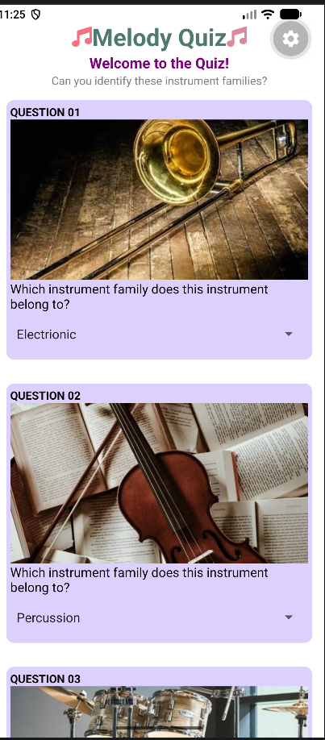
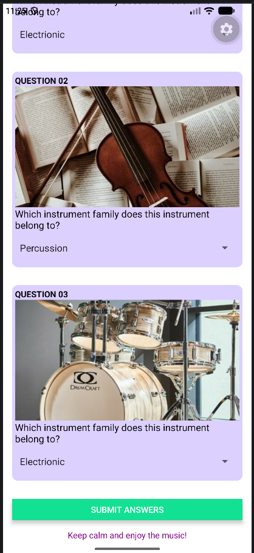

# Melody Quiz

The app allows users to match the musical instrument families with instruments such by selecting their answers from the options and submit them. Then, they will receive their final score and feedback.
# Features Highlight

Highlight the features of your app and describe the concepts applied
- There are 4 answer options across 3 questions: Brass, String, Percussion and Electronic.
- I used React's useState to keep track of the user's selected answers. The selected answers are updated whenever users choose an option from the Picker component.
- I used if statements to check the user's answers. Each correct answer adds one point to the total score.
- I used if, else if and else statements to display different feedback messages based on the user's score, providing encouraging feedback.
- I created a reusable Instrument component in a separate file to display the question number, question, instrument image and answer options. This allows the same component to be reused across all three questions.
- I used the Button component to allow users to submit their answers and check their final score.
- I used Alert.alert() to display different feedback messages and the number of correct answers after submission.
- I used inline styling to customise the app's appearance with font colours, font sizes and more, making the interface visually appealing.

# Screenshots of App

Screenshots:  
### Screenshot 1

### Screenshot 2

# Demo Video

Demo Video Link:  
https://drive.google.com/file/d/16bgSdi_Rh-8J9tLvDyi8IXcX3pVZcgrV/view?usp=sharing 

